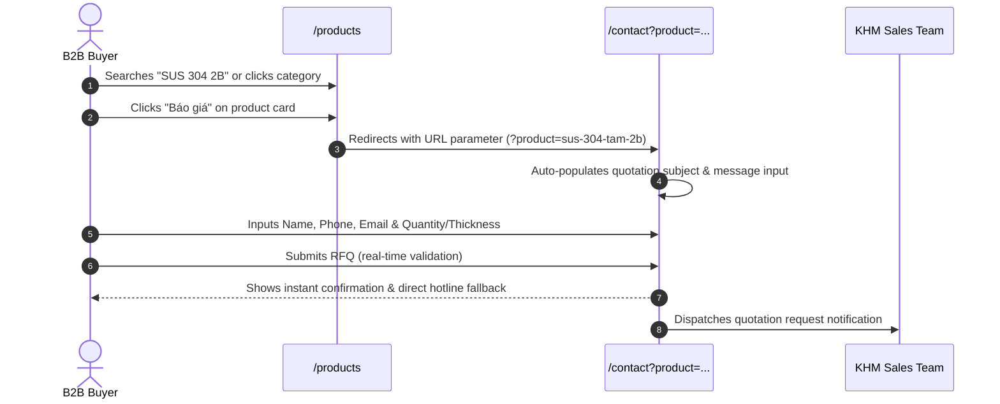

# Kha Hoàng Minh — Information Architecture & User Journeys

> **Scope**: Navigation structures, B2B user personas, primary conversion funnels, URL routing schema, query parameter state management, and SEO metadata architecture.

---

## 1. Primary B2B User Personas & Intent Mapping

```
                                  USER PERSONA TAXONOMY
┌────────────────────────────┬─────────────────────────────┬─────────────────────────────────┐
│ Persona                    │ Primary Motivation          │ High-Priority Landing Sections  │
├────────────────────────────┼─────────────────────────────┼─────────────────────────────────┤
│ 1. Procurement Officer     │ • Immediate availability    │ • /products (Stock Filter)      │
│    (Chuyên viên Mua hàng)  │ • Competitive direct price  │ • /contact (Direct RFQ Form)    │
│                            │ • Genuine CO-CQ credentials │ • Hotlines (0979.866.162)       │
├────────────────────────────┼─────────────────────────────┼─────────────────────────────────┤
│ 2. Mechanical Engineer /   │ • Exact dimensional limits  │ • /services (CNC specs)         │
│    M&E Contractor          │ • Cutting tolerance (±0.1)  │ • /calculator (Weight formula)  │
│    (Kỹ sư Cơ khí / M&E)    │ • CAD drawing submission    │ • /products/[slug] (Tolerances) │
├────────────────────────────┼─────────────────────────────┼─────────────────────────────────┤
│ 3. Project Developer /     │ • Scale proof & references  │ • /projects (F&B / Petro case)  │
│    General Contractor      │ • Stable bulk coil supply   │ • /about (Corporate identity)   │
│    (Tổng thầu / Dự án)     │ • Factory audit & visit     │ • /videos (Warehouse tour)      │
├────────────────────────────┼─────────────────────────────┼─────────────────────────────────┤
│ 4. Job Candidate / Talent  │ • Safe working environment  │ • /careers (Openings & benefits)│
│    (Ứng viên / Thợ CNC)    │ • Welfare & fair incentives │ • /about (Culture & Leadership) │
└────────────────────────────┴─────────────────────────────┴─────────────────────────────────┘
```

---

## 2. Global Navigation Hierarchy

The portal employs a 4-tier navigation layout ensuring frictionless traversal:

```
┌────────────────────────────────────────────────────────────────────────┐
│ TOP CONTACT BAR (Desktop lg+)                                          │
│ • Direct Sales: 0979.866.162 (Ms. Uyên) | 0976.888.999 (Ms. Hải)        │
│ • Email: info@khahoangminh.com.vn | Facilities: Bình Tân & Dĩ An       │
├────────────────────────────────────────────────────────────────────────┤
│ PRIMARY HEADER (Sticky blur)                                           │
│ [LOGO]  Trang chủ | Giới thiệu | Sản phẩm | Dịch vụ | Dự án | Tin tức  │
│         [LanguageToggle: VI/EN] [ThemeToggle: Light/Dark] [BÁO GIÁ CTA]│
├────────────────────────────────────────────────────────────────────────┤
│ MOBILE DRAWER (< 1024px)                                               │
│ • Slide-down full menu with touch targets ≥ 44×44px                    │
│ • Quick hotline dialing buttons & direct Zalo chat button              │
├────────────────────────────────────────────────────────────────────────┤
│ FOOTER (Deep Obsidian #070A10)                                         │
│ • Legal Entity, MST: 0314059766, Director: Bà Ngô Thị Phụng Uyên        │
│ • Dual Addresses: Registered Office (HCM) & Factory (Bình Dương)       │
│ • Policy Links: Bảo vệ dữ liệu cá nhân, Chính sách bảo mật, Điều khoản │
└────────────────────────────────────────────────────────────────────────┘
```

---

## 3. RFQ Query-Param Funnel & Conversion Flow

To streamline the B2B quotation process, the catalog passes contextual material details directly into the contact workflow:



---

## 4. SEO & Canonical Metadata Matrix

Every route segment features tailored OpenGraph, Twitter, and JSON-LD schema metadata:

| Route Path | Canonical Title Tag | Meta Description Focus | Primary Schema |
|---|---|---|---|
| `/` | Kha Hoàng Minh \| Nhà Cung Cấp Inox Hàng Đầu Việt Nam | Direct importer of SUS 304, 316, 201, 430 and CNC processing center. | `Corporation` |
| `/products` | Bảng Giá & Danh Mục Inox Cuộn, Tấm, Ống, Hộp \| Kha Hoàng Minh | Full catalog of stainless steel coils, plates, pipes, and fittings with certified CO-CQ. | `CollectionPage` |
| `/services` | Dịch Vụ Gia Công Inox CNC Plasma, Cắt Laser Fiber \| Kha Hoàng Minh | High-power CNC Plasma & Laser cutting up to 60mm with ±0.1mm accuracy. | `Service` |
| `/contact` | Liên Hệ Báo Giá Inox & Gia Công CNC \| Kha Hoàng Minh | Registered Office in Bình Tân (HCM) & Processing Factory in Dĩ An (Bình Dương). | `ContactPage` |
| `/about` | Giới Thiệu Công Ty Kha Hoàng Minh \| MST 0314059766 | Metallurgical heritage, 2 strategic facilities, Director Ngô Thị Phụng Uyên. | `AboutPage` |
| `/projects` | Dự Án & Năng Lực Cung Cấp Thép Không Gỉ \| Kha Hoàng Minh | Industrial delivery records for F&B, petrochemical, and construction clients. | `PortfolioPage` |
| `/calculator` | Bảng Tính Trọng Lượng Inox Tấm, Cuộn, Ống, Hộp Chuẩn Xác \| KHM | Interactive theoretical weight engineering calculator for SUS 304/316/201/430. | `WebApplication` |
| `/news` | Tin Tức Thị Trường Thép & Kiến Thức Kỹ Thuật Inox \| Kha Hoàng Minh | Stainless steel market trends, nickel prices, and CNC processing guides. | `Blog` |
| `/protection` | Chính Sách Bảo Vệ Dữ Liệu Cá Nhân \| Kha Hoàng Minh | Compliance with Decree 13/2023/NĐ-CP on personal data handling. | `WebPage` |
